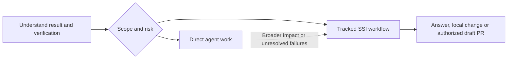
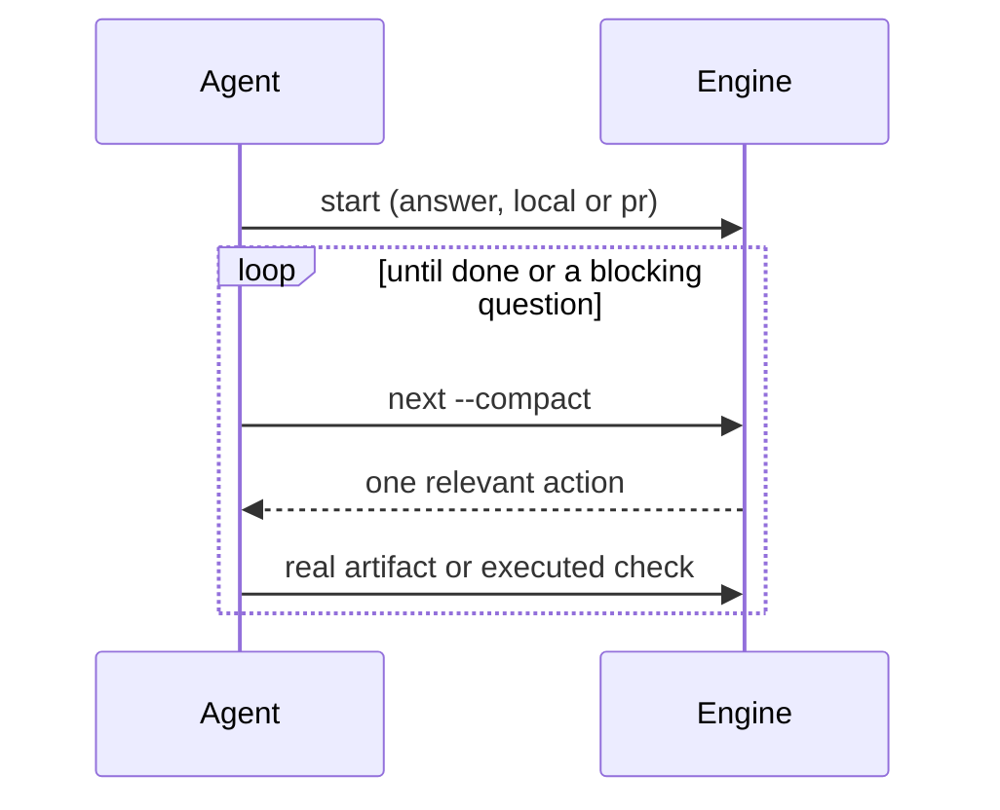

# SSI

Simple, reviewable code with the least necessary workflow. Works with Codex and Claude Code.
SSI 0.3.0 handles small tasks directly and tracks substantial or risky work when tracking is useful.

## Quick install

Clone the repository, then copy the entire skill folder for your agent:

```bash
git clone https://github.com/ssime-git/ssi-ai-skill
cd ssi-ai-skill
# Claude Code
mkdir -p ~/.claude/skills
cp -R skills/ssi ~/.claude/skills/
# Codex
mkdir -p ~/.agents/skills
cp -R skills/ssi ~/.agents/skills/
```

Choose either installation or both. Invoke `/ssi <request>` in Claude Code or `$ssi <request>` in Codex.
Claude Code also supports `claude --plugin-dir .` from this checkout, using `/ssi:ssi`.
Tracked work requires Node 20+ and git. GitHub CLI is needed only for authorized remote work.
Updating the checkout does not update a copied installation: repeat its copy command after `git pull --ff-only`.
Project-local Codex installation and an optional routing reminder: [Codex guide](docs/codex/AGENTS.md).

## How it works



- Clear, confined, low-risk work uses normal agent tools and relevant checks, without SSI state or phase guides.
- Missing requirements get a targeted clarification. Ambiguity alone does not justify tracking.
- Substantial or risky work loads the tracked guide; even a one-line permission change can be risky.
- Direct work can escalate while reusing observations. An active tracked task resumes without bypassing stops.

Explicitly invoking SSI still allows direct work. There is no session-start hook or extra routing model.
The agent makes the routing decision; it is guidance, not a deterministic classifier.
Previously loaded instructions remain in conversation context: SSI does not promise to unload them.

For tracked work only:



## What is different

- Reuse existing code; prefer explicit names, direct control flow and small interfaces over speculative abstractions.
- Local work needs no commit, Issue or PR. Useful follow-ups can stay in a handoff or an authorized Issue.
- Tracked work records progress and retry budgets. Small safe tracked changes skip a separate plan and review.
- `check` executes commands and ties receipts to the code snapshot. Manual evidence is labelled reported.
- `ci` inspects the actual PR commit and check results; absent CI remains unverified. PRs stay draft.
- The SSI engine never merges, closes Issues or deploys. Starting a run grants no extra authorization.

Engine commands, configuration and evidence limits: [design](docs/design.md).
Optional display: `mods/ssi-cockpit`; direct tasks do not appear as tracked runs.

## Reliability and efficiency

Validation passed 158 engine/package tests and 9 evaluation tests. Four direct implementations passed their
held-out assertions across Codex and Claude Code; each host passed eight routing decisions and completed
one tracked answer workflow. These are small smoke tests, not proof of production readiness or perfect answers.
The entrypoint is 52% shorter in bytes; equivalent token savings have not been established.
An earlier engine-only comparison reduced tokens versus SSI 0.2 but cost more than plain Codex on short tasks.

Read the [routing results and limits](docs/routing-evaluation.md), [historical model comparison](docs/model-evaluation.md),
[workflow text benchmark](docs/efficiency.md) and [run history](docs/runs.md).
The evidence supports using SSI with normal human review, not trusting every answer or route automatically.

## Contributing

Run `npm run validate` and `npm test`. See [contributing](CONTRIBUTING.md) for evaluation checks and opt-in model trials.
Design principles: [philosophy](docs/philosophy.md). Changes: [changelog](CHANGELOG.md).

## Inspired by

- [mattpocock/skills](https://github.com/mattpocock/skills) and [jsmastery-pro/skills](https://github.com/jsmastery-pro/skills): engineering practices.
- [DietrichGebert/ponytail](https://github.com/DietrichGebert/ponytail): the smallest useful change.
- [ayghri/i-have-adhd](https://github.com/ayghri/i-have-adhd): clear communication.
- [openai/codex-plugin-cc](https://github.com/openai/codex-plugin-cc): optional read-only review.
- [obra/superpowers](https://github.com/obra/superpowers): the original design process.

Exact source versions and licences: [NOTICE.md](skills/ssi/NOTICE.md).
